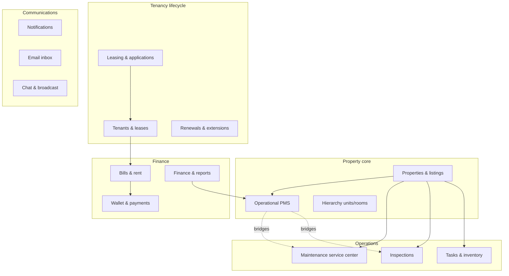

# Enterprise PMS Suite — Upgrade Plan (Leverage Existing)

> **Principle:** No parallel modules. Extend, connect, and harden what already exists across AsherBE, AsherLandlordFE, AsherAdmin, AsherWebUser, and Ashertenant.
>
> **Last updated:** 2026-06-08

---

## 1. Suite map (what you already have)



| Domain | Existing backbone | Primary UI |
|--------|-------------------|------------|
| **Property** | `PropertyServices`, landlord `/api/landlord/properties` | Locations, Details, wizards, bulk CSV |
| **Operational PMS** | `propertyOperational.service`, operational-profile API | Single **Operational** tab |
| **Leasing** | `/api/landlord/application`, `/api/application` | Leasing, Applications, WebUser apply |
| **Tenancy** | `/api/landlord/tenants` | Tenants, tenant details, Ashertenant |
| **Finance** | `/api/landlord/finance`, wallet, transactions, budgets | `/finance` (dashboard, wallet, account integration), property **Finance** tab (bills/transactions), `/report/financial` |
| **Maintenance** | `/api/landlord/maintenance`, `/api/maintenance`, vendor | Service center, Management tab |
| **Inspections** | `/api/landlord/inspections` | Service center + Management tab |
| **Documents** | Uploads, DocuSign, landlord docs, admin library | Files, Templates, property Documents tab |
| **Reports** | `/api/landlord/reports`, analytics | `/report/*`, dashboard cards |
| **Admin** | `/api/admin/*` | AsherAdmin oversight |
| **Public** | `/api/properties` | AsherWebUser search & apply |

---

## 2. Enterprise upgrade phases (extend, don’t replace)

### Phase A — Property hub connections ✅ (in progress)

**Goal:** One property record; operational data links into existing ops workflows.

| Upgrade | Status | Existing system used |
|---------|--------|----------------------|
| Single Operational tab (no split overviews) | ✅ | `OperationalProfileTab` |
| Operational workflow hub (maintenance, inspections, docs, finance, reports) | ✅ | `OperationalWorkflowHub`, `PropertyMaintenanceRequests` |
| Inspection / documents deep links | ✅ | Service center + property tabs |
| Shortlet maintenance list fix | ✅ | Shared maintenance component |
| Create maintenance `?propertyId=` prefill | ✅ | `create.tsx` |
| Wizard operational (res/com/shortlet) | ✅ | `OperationalProfileOptionalSection` |
| Bulk `operationalProfileJson` | ✅ | Bulk upload controller |

### Phase B — Operations consolidation

**Goal:** Service center + property Management tab feel like one system.

| Upgrade | Action | Files / routes |
|---------|--------|----------------|
| Property-scoped maintenance list | ✅ Shared component | `PropertyMaintenanceRequests.tsx` |
| Deep-link Management sub-tabs | Add `?sub=inspections` etc. | `Management.tsx` |
| Inspection create from property | `?propertyId=` on create | `InspectionForm.state.ts` (exists) |
| Operational cert expiry → maintenance CTA | ✅ Bridge copy when expiring | `OperationalWorkflowHub` |
| Unify maintenance API entry | Document canonical paths; deprecate duplicate callers | `docs/` only first |

### Phase C — Finance, deep accounting & compliance alignment

**Goal:** One money story — ledger transactions, operational asset register, and external accounting — without a second ERP.

#### Finance module inventory (already built)

| Layer | Route / component | Data source |
|-------|-------------------|-------------|
| **Portfolio finance** | `/finance` → `Finance.tsx` | Property filter, tabs |
| Finance dashboard | `dashboard.tsx` | `GET /api/landlord/finance/stats`, income/expense breakdown, recent txs |
| Wallet | `Wallet.tsx` | User wallet + transaction history |
| Account integration | `AccountIntegration.tsx` | QuickBooks / Xero / Zoho UI (OAuth next) |
| **Property finance** | Property tab `?tab=finance` | `Rentals/finance/Finance.tsx` — Bills + Transactions |
| **Reports** | `/report/financial` | `FinancialReport.tsx` + reports API |
| **Tenant** | Ashertenant financial analytics | `GET /api/tenants/financial-analytics/*` |

Transaction categories already mapped in `finance.service.ts`: rent, late fees, charges (income); maintenance, bills, supplies, equipment (expense).

#### Upgrade tracker

| Upgrade | Status | Existing system |
|---------|--------|-----------------|
| Compliance report ← operational data | ✅ | `reports.service`, `ComplianceReport.tsx` |
| Dashboard compliance card | ✅ | `dashboard.sections.tsx` |
| Operational → finance deep links | ✅ | `OperationalWorkflowHub` → `/finance?propertyId=` |
| Finance URL deep links (`?propertyId=`, `?tab=`) | ✅ | `Finance.tsx` |
| Operational asset register on finance dashboard | ✅ | `OperationalAssetCostsPanel` (acquisition, insurance, utilities) |
| Account integration tab restored | ✅ | `AccountIntegration.tsx` (connectors UI; OAuth Phase C+) |
| Tenant financial analytics router | ✅ | `financialAnalytics.routes.ts` |
| Late fees ↔ bills catalog | Document linkage | `billCatalog.ts`, `propertyLateFeeSettings` |
| Export txs + asset costs to QuickBooks/Xero | OAuth + sync jobs | Account integration BE (not started) |
| Financial report includes operational asset lines | Extend `reports.service` | Next increment |

### Phase D — Tenancy & documents

**Goal:** Lease lifecycle and document stores interoperate.

| Upgrade | Action | Existing system |
|---------|--------|-----------------|
| Operational `documentId` ↔ property documents | Validate on save; show broken links | `DocumentLinkSelect`, landlord docs API |
| DocuSign agreements ↔ tenant docs | Link from tenant profile | Existing DocuSign + tenant document routes |
| Application → tenant handoff | Already on approve | `application.services` |
| Inspection PDF ↔ compliance certs | Optional attach cert doc to compliance row | Operational upsert + file upload |

### Phase E — Cross-app visibility

| Upgrade | Action | Apps |
|---------|--------|------|
| Public compliance hints | ✅ | WebUser listing detail |
| Tenant compliance indicator | ✅ | Ashertenant tenancy info |
| Admin compliance overview | ✅ | AsherAdmin |
| Landlord identity gate for leasing | ✅ | LeasingIdentityGate |
| Applicant ↔ tenant app overlap | Document which flows live where | WebUser vs Ashertenant |

### Phase F — Hardening & enterprise polish

| Upgrade | Action |
|---------|--------|
| `validate:pms-all` in CI | Run on PR |
| API contract tests | Maintenance, operational, leasing smoke |
| 4-market QA matrix | UK/NG focus; US/IE config-ready |
| Email + in-app compliance reminders | ✅ `runComplianceReminders` |
| Feature flags documented | `PMS_OPERATIONAL_PROFILE`, `PMS_COMPLIANCE_EMAIL` |

---

## 3. What we are NOT building (use existing)

| Don’t build | Use instead |
|-------------|-------------|
| New maintenance module | Service center + `PropertyMaintenanceRequests` |
| Separate Asset / Insurance / Utilities tabs | Single Operational tab |
| New accounting ERP | `/finance` + Account Integration + reports; OAuth sync when ready |
| New document CMS for landlords | Files + DocuSign + property Documents tab |
| New inspection product | Service center inspections |
| New tenant maintenance app | Ashertenant maintenance APIs |

---

## 4. Property Details tab model (enterprise, single overview per domain)

| Tab | Module | Upgrade focus |
|-----|--------|---------------|
| Overview | Listing & media | — |
| Hierarchy | Units/rooms/listings | — |
| Performance | Analytics | Tie to reports API |
| Tenants | Tenancy | Link to leasing history |
| Finance | Rent & bills | Portfolio `/finance` + property bills; asset register panel |
| Documents | Uploads | Link from operational certs |
| **Operational** | PMS profile | **Hub** → maintenance, inspections, docs, finance |
| Management | Tasks, maintenance, inventory, inspections | Shared maintenance list |
| Vendors | Jobs | Service center |
| Activity | Logs | Engagement + ops events |

Shortlet (when `ENABLE_STANDALONE_SHORTLET_NAV`): bookings, guests, maintenance, operational — same operational config as residential.

---

## 5. Verification commands

```bash
cd AsherBE
npm run validate:pms-all
npm run compliance:reminders
npm run verify:operational-profile
```

---

## 6. Related specs

- `PROPERTY_PMS_SPEC.md` — operational data layer
- `TENANT_SCREENING_SPEC.md` — leasing / screening
- `plan.md` — phase tracker & gap scorecard
